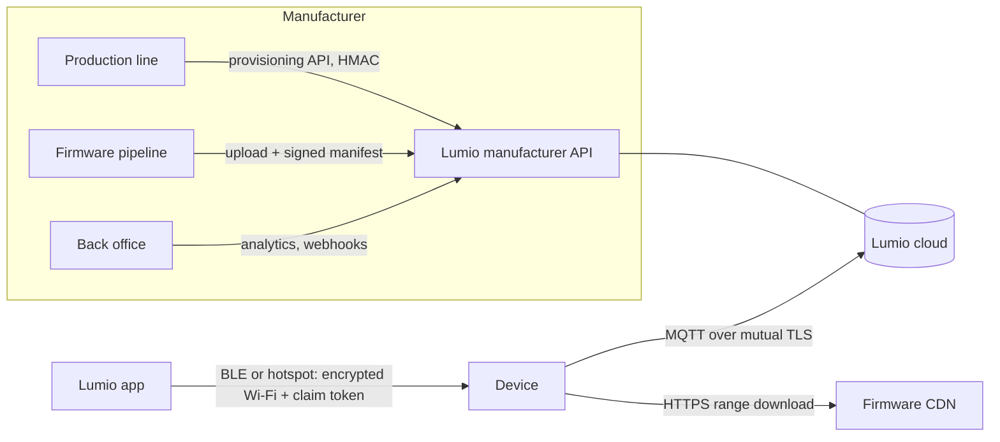

# 1. Overview: integrating a device

Lumio connects devices from many manufacturers to one app. Users pair devices to a home, control actuators, see
sensor data, automate and receive alerts. Manufacturers register hardware types, provision units at the factory, ship
firmware updates and watch the health of their fleet.

## Integration steps

1. **Sign up** as a manufacturer in the Lumio portal. You get a short id `{mid}` (3-8 lowercase letters/digits,
   e.g. `acme`) that prefixes every device id and topic. It cannot change after activation.
2. **Register a hardware type** (`POST /mfr/hw-types`): model code, category, channels and capabilities
   ([schemas/capabilities.json](../schemas/capabilities.json)), pairing methods, and the Ed25519 public key that signs
   your firmware. Submit it for review. Until it is approved, only units you mark as test devices can be paired.
3. **Create an API key** in the portal and link it to the hardware type. Production lines sign provisioning requests
   with it ([09](09-manufacturer-api.md)).
4. **Provision each unit** at the factory: the device generates its key pair, the line sends the CSR, Lumio returns
   the device certificate, CA chain and a claim secret for the QR label ([02](02-device-identity.md)).
5. **Pairing** in the user's home: the app hands the device Wi-Fi credentials and a claim token over Bluetooth LE or
   the device hotspot, encrypted to the device key; the device connects and claims itself ([04](04-pairing.md)).
   Online devices can also be claimed by scanning the QR code.
6. **Runtime**: telemetry, events and state go up; desired state comes down ([03](03-mqtt.md),
   [05](05-state-and-commands.md), [06](06-events.md)).
7. **Firmware updates**: upload a signed image, run a staged campaign, devices verify and install it
   ([07](07-firmware-updates.md)).
8. **Fleet health and notifications**: devices send analytics; you read aggregates and receive webhooks
   ([10](10-analytics.md), [08](08-webhooks.md)).

## Principles

- **The device shadow is the only command path.** The cloud publishes a retained desired state; the device applies
  it and reports. Offline devices converge when they reconnect.
- **The cloud alone cannot ship firmware.** Images are signed with your key and verified by the device bootloader.
- **Billing never bricks a home.** If your API key is suspended, new provisioning, claims and firmware publishing stop,
  but claimed devices keep working.
- **Privacy.** Manufacturers see their fleet (counts, versions, health aggregates), never who owns a device or where
  it is. Analytics carry no user data, and aggregates over fewer than 5 devices are withheld.

## Terms

| Term | Meaning |
| --- | --- |
| `mid` | Manufacturer short id, e.g. `acme` |
| `did` | Device id `{mid}-{serial}`, e.g. `acme-P2A1B2C3D4`: MQTT client id and certificate CN |
| HW type | A model: channels, capabilities, pairing methods, firmware key |
| Channel | One function of a device (`switch_1`, `power`, `temperature`) with a catalogue capability |
| Claim | Binding a device to a home; needs a claim token (pairing) or the claim secret (QR) |
| Shadow | Desired and reported state of a device, kept by the cloud |
| Campaign | Staged firmware rollout over a share of the fleet |
