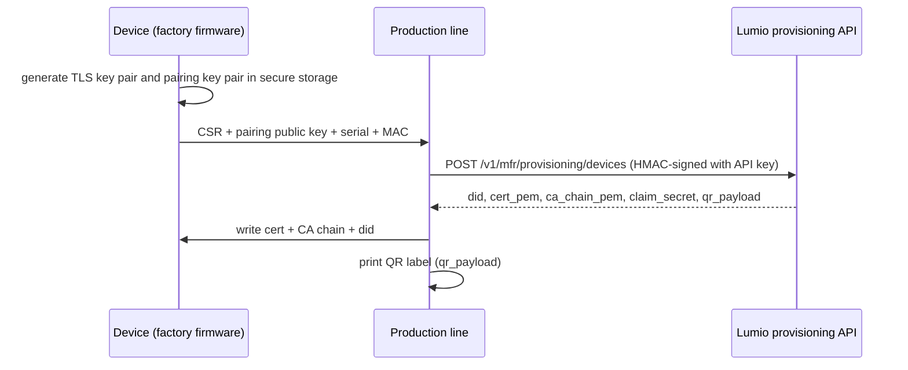

# 2. Device identity and authorisation

Every unit has its own identity. There are no shared secrets across a product line.

## Device id

`did = {mid}-{serial}`, pattern `^[a-z0-9]{3,8}-[A-Za-z0-9]{8,32}$`. The serial you send at provisioning must be
8-32 letters or digits and unique per manufacturer. The did is the MQTT client id, the certificate CN, and appears in
every topic.

## Provisioning at the factory

1. The device generates its **TLS key pair** on the device (P-256 ECDSA preferred, Ed25519 accepted). The private key
   never leaves the device; use the secure element or encrypted flash where the chip has one.
2. The production line sends the CSR (`POST /mfr/provisioning/devices`, or `:batch` for up to 1,000 units). The CSR
   subject is ignored: Lumio issues a certificate with CN = did and the HW type id in extension OID
   `1.3.6.1.4.1.<pen>.1`, valid 20 years, signed by the Lumio Device CA.
3. Store `cert_pem` and `ca_chain_pem` on the device. The CA chain is also the trust anchor for the broker's server
   certificate: pin it, do not use a public CA bundle.
4. The response contains a **claim secret** (26 base32 characters) and `qr_payload` =
   `lumio://claim?did=<did>&cs=<claim secret>` ([schemas/provisioning/claim-uri.json](../schemas/provisioning/claim-uri.json)).
   Lumio stores only a hash: print the QR on the device label or box now; it cannot be fetched again.
5. Units that pair over Bluetooth LE or Wi-Fi setup mode also generate a separate **pairing key pair** (P-256, used
   only for ECDH, [04](04-pairing.md)) and send its public key as `pairing_pubkey` (uncompressed point, base64). The
   app checks the key the device presents against this registered one, so a look-alike device cannot capture the
   home's Wi-Fi password. Do not reuse the TLS signing key for ECDH.

Requests must use an **active** API key linked to the hardware type; a suspended key gets `403 api_key_suspended`,
an unlinked HW type `403 forbidden`, a duplicate serial `409 conflict`.

## Connecting with a certificate (preferred)

Mutual TLS on port 8883, TLS 1.2 or newer (1.3 preferred), client id = did. The broker refuses the connection when the
certificate is revoked, the device is disabled, or the HW type is not approved (except your test devices).

## Connecting with a pre-shared key (fallback)

For hardware that cannot do mutual TLS, provision with `psk` (32-128 characters from `[A-Za-z0-9_-]`, at least 128
bits of entropy) instead of a CSR. Such devices are marked **low trust** (some features, such as door locks, may be
restricted). Connect with server-authenticated TLS and:

- username: the did
- password: `v1.<unix seconds>.<nonce>.<hex(HMAC-SHA256(psk, "<did>.<unix seconds>.<nonce>"))>`

The nonce is 16-32 random lowercase hex characters, never reused; the broker accepts timestamps within ±300 s, so the
device needs SNTP time before connecting. The HMAC key is the UTF-8 bytes of the PSK string. Vector:
[test-vectors/psk-mqtt-password.json](../test-vectors/psk-mqtt-password.json).

## Revocation

`POST /mfr/provisioning/devices/{did}/revoke` (stolen or defective units) disables the device; the broker closes its
connection within 60 seconds and refuses new ones.

## Factory reset

A factory reset (long button press, or the `factory_reset` desired state) erases Wi-Fi credentials, the claim binding
and user data, but **keeps** the did, certificate and keys. The device reports an `event` with channel `device`,
type `reset` before erasing the network settings ([06](06-events.md)), then reboots into pairing mode.
