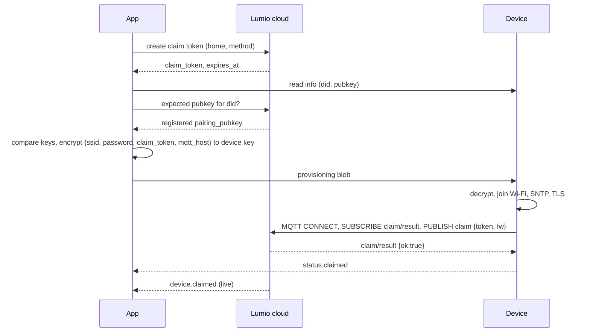

# 4. Pairing: registering a device to a user's home

A new or factory-reset device has no network and no owner. Pairing gives it Wi-Fi credentials and a **claim token**
(one device, one home, valid 10 minutes). The device then connects and claims itself. Supported methods per HW type:
`ble`, `wifi_ap`, `qr`, `gateway`.

## Bluetooth LE

The device advertises while unclaimed (and for 10 minutes after a factory reset or a long button press):

- Advertising data: complete list of 128-bit service UUIDs with `6c756d69-6f00-4b1e-9e00-000000000001`.
- Scan response: complete local name `Lumio-XXXX` (last 4 characters of the did).
- Stop advertising once claimed.

GATT service `6c756d69-6f00-4b1e-9e00-000000000001`:

| Characteristic | UUID | Properties | Content |
| --- | --- | --- | --- |
| info | `…0002` | read | [DeviceInfo](../schemas/provisioning/device-info.json) JSON, ≤ 512 bytes (long read) |
| provision | `…0003` | write (with response) | provisioning blob in frames (below) |
| status | `…0004` | read, notify | [ProvisionStatus](../schemas/provisioning/provision-status.json) JSON |

**Frames.** The blob is longer than one ATT write. Each write is `header (1 byte) | data`, at most ATT MTU − 3 bytes;
header bit 7 marks the last frame and bits 0-6 hold the frame index (0, 1, 2 …, at most 128 frames). The device
appends frames in order, starts over on index 0, and answers an out-of-order frame with status `failed`
/`payload_invalid`. The app should request a larger MTU (247) first. Vector:
[test-vectors/provision-blob.json](../test-vectors/provision-blob.json) (`ble_frames_hex`, 20-byte writes).

## Wi-Fi setup mode (device hotspot)

For devices without Bluetooth, or as a fallback: the device opens an access point `Lumio-XXXX` and serves the HTTP
API in [openapi/device-local.yaml](../openapi/device-local.yaml) on `http://192.168.4.1`:
`GET /info` (DeviceInfo), `POST /provision` (the blob as `application/octet-stream`, answered `202` before leaving the
hotspot), `GET /status` (ProvisionStatus). Close the hotspot after a successful claim, after 15 minutes without a
request, or after 5 blobs that fail to decrypt.

## Provisioning blob

The Wi-Fi password must not travel in clear text, and must reach only the genuine device:

1. The app reads `pubkey` from `info` and compares it with the `pairing_pubkey` registered at provisioning (the app
   gets it from the cloud). Mismatch → the app stops.
2. The app creates an ephemeral P-256 key pair, computes the ECDH shared secret with the device key (32-byte X
   coordinate), and derives the key: `HKDF-SHA256(ikm = shared secret, salt = app ephemeral public key (65 bytes) ||
   device public key (65 bytes), info = "lumio-provision-v1", length = 32)`.
3. It encrypts the UTF-8 JSON [ProvisionPayload](../schemas/provisioning/provision-payload.json) (≤ 512 bytes) with
   AES-256-GCM, a random 12-byte nonce, and the did (UTF-8) as additional authenticated data.
4. Blob = `0x01 (version) | app ephemeral public key (65, uncompressed) | nonce (12) | ciphertext | tag (16)`.

The device decrypts with its pairing private key; any failure (wrong version, tag, did) → status `failed` /
`decrypt_failed`. Keep the Wi-Fi credentials only in the secure credential store; never log them or the claim token.

## Claiming over MQTT

After joining Wi-Fi the device reports `wifi_connecting` → `cloud_connecting` → `claiming` and:

1. Connects ([03](03-mqtt.md)) to `mqtt_host`, subscribes to `claim/result`, publishes
   [ClaimMsg](../schemas/mqtt/claim.json) `{token, fw}` (QoS 1). HW types that allow device-reported channels may add
   `channels`.
2. Waits up to 15 s for [ClaimResultMsg](../schemas/mqtt/claim-result.json); republishes the same claim (same token,
   next `seq`) up to 3 times, then reports `failed` / `claim_timeout`.
3. `ok: true` → status `claimed`; stop BLE advertising / close the hotspot. `ok: false` → status `failed` /
   `claim_rejected` with `claim_reason`:

| reason | Meaning | Device action |
| --- | --- | --- |
| `invalid_token` | Unknown token or for another device | Back to pairing mode |
| `expired` | More than 10 minutes since the token was issued | Back to pairing mode; the app gets a new token |
| `already_owned` | Device belongs to another home | Back to pairing mode; the user must request a transfer |
| `hw_not_approved` | HW type not approved and the unit is not a test device | Back to pairing mode |
| `key_suspended` | The unit's API key is suspended (new claims only) | Back to pairing mode |

Keep the Wi-Fi credentials when the claim fails only if the user can retry without re-entering them; otherwise erase
them. A claimed device keeps working through API key suspension.

## QR claim (devices already online)

Devices with Ethernet/LTE, or already connected, can be claimed by scanning the label: the app parses
`lumio://claim?did=…&cs=…` and the cloud binds the device without a device round-trip. Five wrong secrets lock QR
claiming of that device for 1 hour. The device sees nothing but the desired state that follows.

## Through a gateway

When the user adds a sub-device via a hub, the cloud sets `join_mode` (seconds, ≤ 600) and `join_token` (a claim
token) in the gateway's desired state. The gateway opens its radio network for that long and publishes a claim for
each sub-device that joins, on `dev/{mid}/{gateway did}/sub/{sub did}/claim` with `token` = `join_token`; the answer
comes on the sub-device's `claim/result`. Sub-devices get the gateway as parent. Close the network when `join_mode`
ends or is removed from the desired state.

## Removal and transfer

When the owner removes a device, the cloud sets `factory_reset: true` in the desired state. The device reports the
`reset` event, erases Wi-Fi and owner data, and returns to pairing mode. A second-hand device that is still owned by
someone else answers `already_owned`; after a factory reset on the device the new user can request a transfer,
which Lumio support approves.
