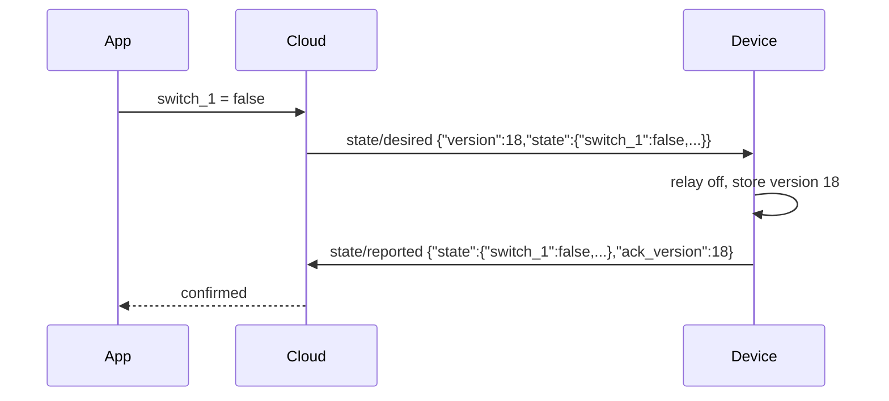

# 5. State and commands (device shadow)

The cloud keeps a **shadow** per device: the *reported* state (what the device says) and the *desired* state (what
users, automations and schedules want). Commands reach the device only as desired state: there is no other command
path, so a device that was offline converges when it reconnects.

## Desired state (cloud → device)

Topic `dev/{mid}/{did}/state/desired`, QoS 1, **retained**, schema [DesiredStateMsg](../schemas/mqtt/state-desired.json):

```json
{"v":1,"version":17,"state":{"switch_1":true,"brightness":60},"issued_by":"user"}
```

- `state` is the **complete** desired state, not a delta. Keys are channel names; values follow the channel's
  `range`/`enum` from the HW type. The cloud validates values before publishing.
- `version` increases with every change. Persist the last applied version in non-volatile storage. On receipt:
  if `version` ≤ last applied → ignore (it is a redelivery of the retained message); otherwise apply every key,
  then report.
- Apply what you can. If a value cannot be applied (hardware fault, out of range), keep the actual value in the
  reported state and send an `event` on that channel with type `command_failed` and `data.code`.
- `ttl_s`, when present, is informational: the cloud clears the retained command after that time.
- `issued_by` tells you whether a user, an automation or a schedule asked (for logging or LED feedback only).

Reserved keys (not channels):

| Key | Value | Action |
| --- | --- | --- |
| `factory_reset` | `true` | Report a `reset` event on channel `device`, erase Wi-Fi and owner data, reboot into pairing mode |
| `join_mode` | 1-600 | Gateways only: accept new sub-devices for this many seconds |
| `join_token` | claim token | Gateways only, with `join_mode`: the token for the sub-devices' claim messages |

## Reported state (device → cloud)

Topic `dev/{mid}/{did}/state/reported`, QoS 1, **retained**, schema [ReportedStateMsg](../schemas/mqtt/state-reported.json):

```json
{"v":1,"ts":1761210004000,"seq":45,"boot":"b7Kq2Xp9","state":{"switch_1":true,"brightness":60},"ack_version":17,"fw":"1.4.2","rssi":-61}
```

Publish the full state of every actuator channel:

- after every connect,
- after applying desired state, with `ack_version` = the applied `version`,
- after a local change (physical button, local schedule), keeping the last `ack_version`.

The app shows a command as pending until `ack_version` ≥ its version and reverts after 5 seconds without it, so
acknowledge quickly (target: under 300 ms from receipt). `fw`, `rssi` and `battery` update the device card.

## Example: a tap in the app


